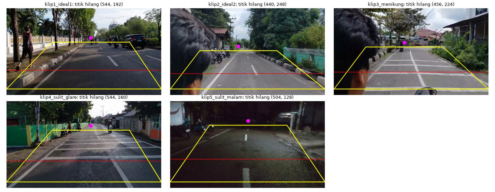
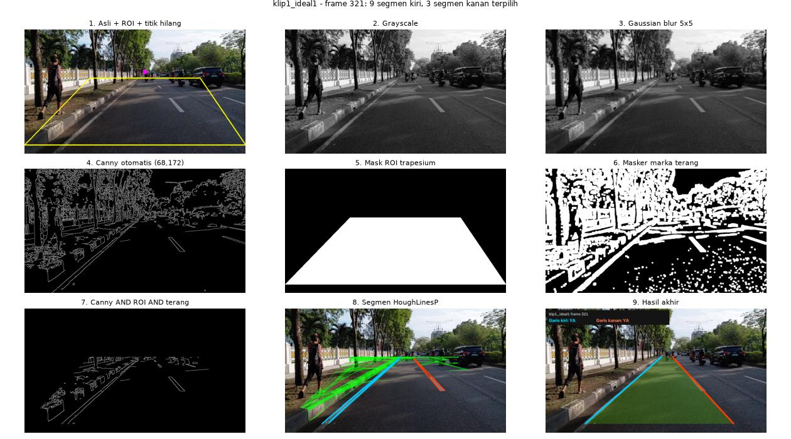
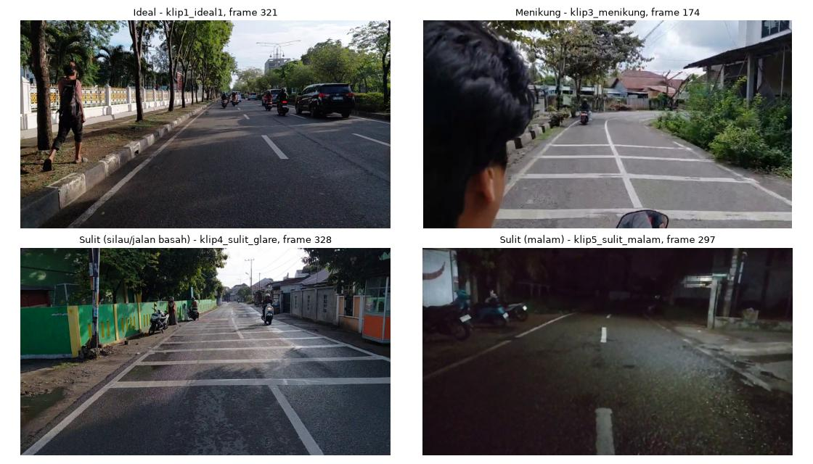
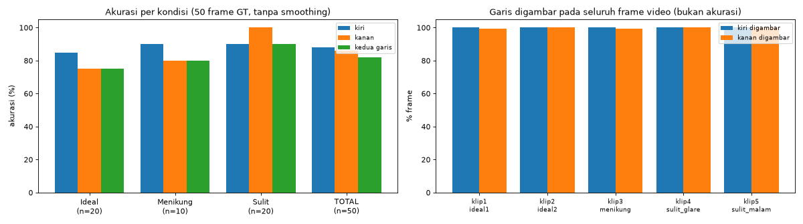
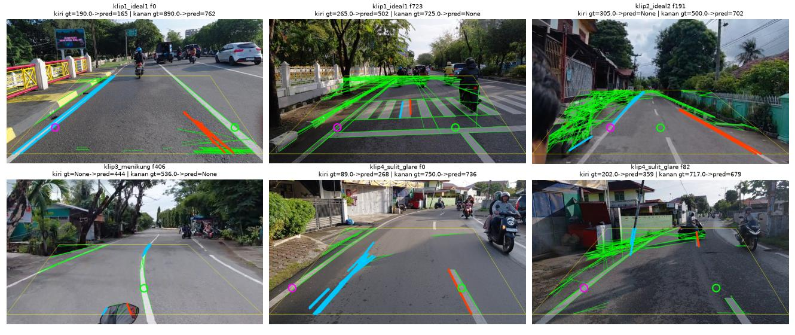
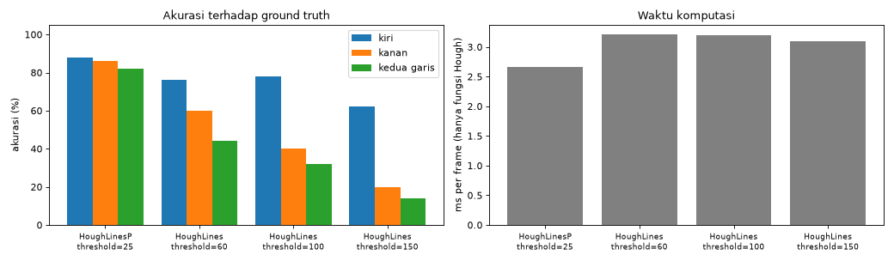
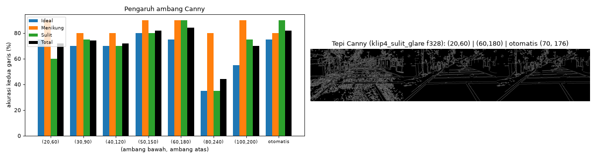

# Deteksi Marka Jalan pada Video

Proyek UTS Pengolahan Citra & Visi Komputer — **Kelompok 06, Tema 6**.

🌐 **Website:** _(tempel URL Streamlit di sini, misalnya `https://deteksi-marka-jalan-pada-video.streamlit.app`)_

---

## Nama Anggota Tim dan NPM

| No | Nama Anggota | NPM |
| :-: | :--- | :---: |
| 1 | Riyan Hadi Samudra | 2308107010068 |
| 2 | Muhammad Fanzal Rivaldi | 2308107010077 |
| 3 | Farhan Mujiburrahman | 2308107010078 |
| 4 | Razian Sabri | 2308107010050 |

---

## Deskripsi

Program ini mendeteksi **garis marka lajur kiri dan kanan** pada setiap frame video jalan yang direkam dari kendaraan, lalu menyimpan video hasil yang sudah diberi garis (`.mp4`). Seluruh proses memakai pengolahan citra klasik dengan `opencv-python`, `numpy`, dan `matplotlib`, **tanpa deep learning**.

Pipeline bersifat **universal**: video apa pun cukup dimasukkan tanpa mengatur angka. Hanya ada satu set parameter untuk semua video. ROI, baris acuan, dan ambang Canny **dihitung otomatis dari isi videonya sendiri**, tidak disetel per video.

- **Garis kiri** adalah garis tepi jalan di sisi kiri lajur kendaraan.
- **Garis kanan** adalah marka tengah (putus-putus atau menerus) di sisi kanan lajur kendaraan.

---

## Pipeline

```
Video ──► Kalibrasi otomatis (sekali per video) ──► titik hilang + batas bawah jalan ──► ROI trapesium
                                                                                            │
Per frame:  VideoCapture → resize (sisi terpanjang 1000 px) → grayscale → Gaussian blur 5×5
            → Canny (ambang otomatis) ∩ mask ROI trapesium ∩ masker marka terang
            → HoughLinesP → pilih garis kiri/kanan → regresi garis → smoothing → VideoWriter (.mp4)
```


*Titik hilang (magenta), ROI trapesium (kuning), dan baris acuan (merah) yang dihitung otomatis pada kelima klip.*

1. **Kalibrasi otomatis (`kalibrasi_video`)**: dilakukan sekali per video dari 30 frame yang tersebar merata.
   - **Titik hilang:** dicari dengan voting segmen `HoughLinesP`. Sebuah titik hanya mendapat skor tinggi bila segmen **kiri dan kanan** sama-sama mengarah ke titik itu, dan segmen berada di bawahnya.
   - **Batas bawah jalan:** dicari dari kemiripan warna aspal (HSV), yaitu tempat kap mobil atau dasbor motor mulai.
2. **Praproses (`praproses`)**: `cv2.resize` hingga sisi terpanjang 1000 px (`INTER_AREA`), `cvtColor` ke grayscale, lalu `GaussianBlur` 5×5 untuk meredam butiran aspal.
3. **Segmentasi (`segmentasi`)**: tepi diambil dengan `cv2.Canny`, lalu disaring dua lapis.
   - **Ambang Canny otomatis:** ambang atas = persentil ke-97 besar gradien di dalam ROI, ambang bawah = 0,4 × ambang atas. Ambang ikut turun pada video gelap atau buram.
   - **Mask ROI trapesium:** dibuat dengan `fillPoly` dan diterapkan dengan `bitwise_and`, untuk membuang langit, pohon, bangunan, dan kap/dasbor.
   - **Masker marka terang:** `adaptiveThreshold` dengan C negatif, untuk membuang tepi retakan, bekas ban, dan bayangan, yang lebih gelap daripada sekitarnya.
4. **Deteksi (`deteksi`)**: `cv2.HoughLinesP` (`threshold`=25, `minLineLength`=25, `maxLineGap`=60).
   - Segmen yang tidak mengarah ke titik hilang dibuang.
   - Sisa segmen dipisah kiri/kanan menurut kemiringan, lalu dipilih kelompok garis **terdekat ke kendaraan** yang lebih terang daripada aspal di sekitarnya.
   - Garis dibentuk dengan regresi berbobot `np.polyfit`, lalu diperiksa konsistensi geometrinya: kiri tidak boleh menyilang kanan.
5. **Visualisasi (`gambar_hasil`)**: garis kiri (biru muda), garis kanan (merah), dan area lajur (hijau). *Smoothing* EMA antar-frame dipakai untuk video.


*Hasil antara setiap tahap pada klip 1.*

---

## Dataset

Direkam sendiri dengan kamera HP dari kendaraan (penumpang, bukan pengemudi). Video di-resize di dalam program hingga sisi terpanjang 1000 px.

| Klip | Kondisi | Berkas | Resolusi | FPS | Frame | Durasi |
| :-- | :-- | :-- | :-: | :-: | :-: | :-: |
| klip1_ideal1 | Ideal (siang, jalan lurus) | `dataset/ideal/20261024_075053.mp4` | 1920×1080 | 29,9 | 724 | 24,2 s |
| klip2_ideal2 | Ideal (siang, jalan lurus) | `dataset/ideal/WhatsApp Video 2026-10-24 at 09.30.44.mp4` | 848×478 | 29,9 | 576 | 19,3 s |
| klip3_menikung | Jalan menikung | `dataset/jalan menikung/WhatsApp Video 2026-10-24 at 09.30.37.mp4` | 848×478 | 29,7 | 523 | 17,6 s |
| klip4_sulit_glare | Sulit (aspal basah/silau) | `dataset/sulit/20261024_074800.mp4` | 1920×1080 | 30,0 | 741 | 24,7 s |
| klip5_sulit_malam | Sulit (malam hari) | `dataset/sulit/malam.mp4` | 854×480 | 59,1 | 671 | 11,4 s |

**Total: 5 klip, 3.235 frame.** Ada juga satu video tambahan, `dataset/WhatsApp Video 2026-10-29 at 21.01.25.mp4`, yang direkam dari motor dengan HP posisi potret. Video ini tidak punya ground truth dan dipakai untuk uji tanpa pengaturan.

**Ground truth (`dataset/ground_truth.csv`)** dianotasi manual: 10 frame per klip (50 frame). Kolomnya:
- `left_visible` / `right_visible`: apakah garis kiri/kanan terlihat (`Ya`/`Tidak`).
- `left_x` / `right_x`: posisi x garis pada baris anotasi `y_ref`.



---

## Hasil

Kriteria benar: garis terdeteksi dan posisinya **≤ 50 px** dari anotasi manual. Bila ground truth `Tidak`, program tidak boleh menggambar garis. Evaluasi utama dilakukan per frame tanpa smoothing.

| Kondisi | n | Garis kiri | Garis kanan | Kedua garis benar |
| :-- | :-: | :-: | :-: | :-: |
| Ideal | 20 | 85% | 75% | 75% (15/20) |
| Jalan Menikung | 10 | 90% | 80% | 80% (8/10) |
| Sulit — basah/silau | 10 | 80% | 100% | 80% (8/10) |
| Sulit — malam | 10 | 100% | 100% | 100% (10/10) |
| **Total** | **50** | **88%** | **86%** | **82% (41/50)** |

- Pada **video akhir (dengan smoothing)**, kedua garis benar pada **86% (43/50)** frame ground truth.
- Seluruh 3.235 frame diproses dan ditulis ke 5 video `.mp4`, dengan kecepatan sekitar 20–36 FPS di laptop.
- **Dibanding versi awal yang ROI-nya diatur manual per klip** (84% per frame, 80% pada video):
  - Versi universal sedikit lebih rendah per frame tetapi lebih baik pada video.
  - Frame dengan garis kiri-kanan menyilang turun dari 15/10/40/38/0% menjadi 10/1/7/6/0% (klip 1–5).



**Kegagalan utama:**
- Zebra cross, trotoar, tiang, dan tambalan aspal yang lurus dan terang kadang terpilih sebagai marka.
- Marka yang jauh di tepi frame kalah oleh objek yang lebih dekat ke kendaraan.
- Garis lurus tidak bisa mengikuti tikungan tajam.

Contoh dan penjelasan lengkapnya ada di Bagian 7 notebook.



**Keterbatasan:** parameter dipilih dengan melihat 50 frame yang sama dengan evaluasi, sehingga tidak ada data uji terpisah. Angka di atas kemungkinan masih optimistis.

---

## Eksperimen Pembanding

Semua eksperimen dijalankan pada 50 frame ground truth dengan kriteria yang sama.

### 1. `HoughLines` vs `HoughLinesP`

Edge map, ROI, pemilihan garis, dan fitting dibuat identik. Yang berbeda hanya detektor garisnya.

| Metode | Parameter | Kiri | Kanan | Kedua garis | Waktu Hough |
| :-- | :-- | :-: | :-: | :-: | :-: |
| **HoughLinesP** | threshold=25, minLen=25, gap=60 | 88% | 86% | **82%** | 2,6 ms |
| HoughLines | threshold=60 | 76% | 60% | 44% | 3,1 ms |
| HoughLines | threshold=100 | 78% | 40% | 32% | 3,2 ms |
| HoughLines | threshold=150 | 62% | 20% | 14% | 3,2 ms |

`HoughLines` menghasilkan garis tak hingga, sehingga tidak bisa memisahkan potongan marka putus-putus dari objek lain. Makin tinggi threshold-nya, makin banyak marka yang hilang. `HoughLinesP` memberi segmen berhingga yang bisa disambung lewat `maxLineGap`.



### 2. Pengaruh ambang bawah/atas `cv2.Canny`

| Canny | (20,60) | (30,90) | (40,120) | (50,150) | (60,180) | (80,240) | (100,200) | **otomatis** |
| :-- | :-: | :-: | :-: | :-: | :-: | :-: | :-: | :-: |
| Kedua garis benar | 72% | 74% | 72% | 82% | 84% | 44% | 70% | **82%** |

- Ambang terlalu rendah membanjiri Hough dengan tepi aspal, sedangkan ambang terlalu tinggi menghilangkan marka tipis.
- Ambang tetap terbaik, (60,180), memang dipilih dengan melihat dataset yang sama.
- Pada video motor beresolusi rendah, persentase frame dengan garis kiri tergambar:

| Ambang Canny | Garis kiri tergambar |
| :-- | :-: |
| (60,180) | 68% frame |
| Aturan median kecerahan | 32% frame |
| **Otomatis** | **93% frame** |

Karena itu ambang otomatis yang dipakai.



---

## Cara Install di Laptop Lokal

**1. Clone repo dan buat virtual environment** (Python 3.10+):
```bash
git clone https://github.com/rynhdsmdr/Deteksi-Marka-Jalan-pada-Video.git
cd Deteksi-Marka-Jalan-pada-Video
python -m venv venv
source venv/bin/activate          # Windows: venv\Scripts\activate
pip install -r requirements.txt
pip install streamlit imageio-ffmpeg jupyter
```

**2. Jalankan website** (unggah video → video asli dan hasil berdampingan + informasi hasil):
```bash
streamlit run app.py
```
Lalu buka `http://localhost:8501`.

**3. Jalankan notebook** (seluruh eksperimen dan evaluasi, *Restart & Run All*, sekitar 4 menit):
```bash
jupyter notebook UTS_Kelompok06real.ipynb
```

**4. Proses video sendiri lewat terminal**, tanpa mengatur angka:
```bash
python deteksi.py video_jalan.mp4                  # hasil -> hasil_video_jalan.mp4
python deteksi.py video_jalan.mp4 -o keluaran.mp4
```

Asumsi rekaman: kamera menghadap lurus ke depan dari kendaraan, dan jalan bermarka terlihat di frame.

### Struktur repo
```text
├── UTS_Kelompok06real.ipynb   # Notebook utama (8 bagian)
├── app.py                     # Website Streamlit
├── lane_pipeline.py           # Fungsi pipeline (sama persis dengan notebook)
├── deteksi.py                 # CLI pemrosesan video
├── requirements.txt
├── dataset/                   # 5 klip + video uji + ground_truth.csv
└── output/                    # Gambar, tabel CSV, dan ringkasan_evaluasi.json hasil notebook
```

---

## Sumber Kode
- Dokumentasi resmi OpenCV dan modul praktikum P2–P4.
- Ambang Canny dari persentil gradien dengan rasio 0,4 mengikuti cara fungsi `edge(I, 'canny')` MATLAB (dokumentasi MathWorks).
- Kalibrasi titik hilang, batas bawah jalan dari warna aspal, ambang Canny otomatis, dan masker marka terang disusun dengan bantuan asisten AI (Claude, Anthropic), lalu diuji dan disesuaikan oleh kelompok.
